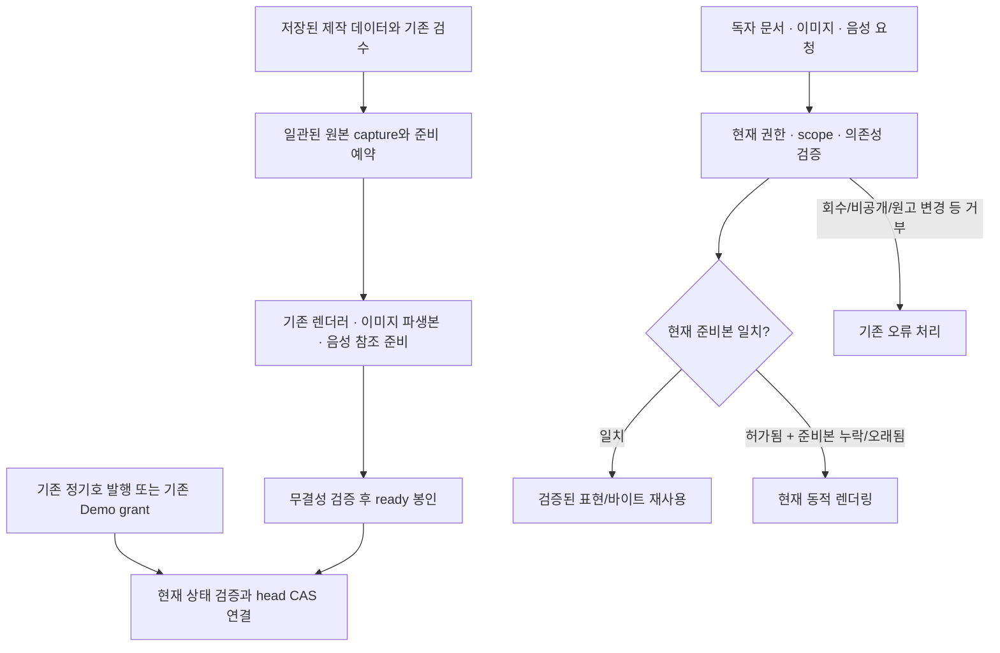

# 발행 버전별 콘텐츠 사전 준비 — 아키텍처 v1.0

- 작성일: 2026-10-30 (Asia/Seoul).
- 기준: 고정 Staging / PR #289 `51537b51176b9427368c6705a2cf4549872fe5eb`. PR #287~#289의 동작을 유지한다.
- 상태: 설계안. 이 문서는 코드·SQL·환경설정·DB·Storage·발행 상태를 변경하지 않는다. 원격 스키마의 설치 여부를 새로 실사한 결과가 아니다.
- 관련 문서: [검증 계획](publication-prepared-content-test-plan-v1.md), [적용 계획](publication-prepared-content-rollout-v1.md).

## 1. 결정 요약

준비본은 **현재 공개 가능한 저장본을 빠르게 표현하는 파생 데이터**다. 새 발행 권한이나 초안과 분리된 고정 공개본을 만들지 않는다. 정기호는 발행 후 저장 수정이 즉시 반영되는 현재 계약을 유지한다.

v1은 신규 테이블 2개와 내부 RPC 4개를 제안한다. 기존 프로젝트·기사 컬럼, 발행 이벤트, 독립 기사 발행 설계는 바꾸지 않는다. 준비 결과·불변 파생 바이트는 재사용하지만 **접근 허가와 최신성 판단은 매 요청 새로 수행**한다.

v1의 최신성 기준은 실제 원본 의존성을 한 MVCC snapshot에서 다시 읽어 계산한 digest다. 모든 저장 경로를 포괄하지 못하는 `updated_at`, TTL, 비동기 무효화 알림, 임의의 dirty flag만으로 준비본을 제공하지 않는다. 이 선택은 DB 원본 읽기 비용을 남기는 대신 기존 저장 계약을 안전하게 유지한다. 더 가벼운 변경 세대값은 모든 writer의 정합성을 증명한 이후 별도 설계 대상이다.

## 2. 현재 계약 및 병목

| 근거 코드·문서 | 현재 계약 | 준비본에서 지킬 경계 |
|---|---|---|
| [`project-publish/route.ts`](../src/app/api/project-publish/route.ts), [`project-publication.ts`](../src/lib/project-publication.ts) | same-origin, 관리자/담당자 접근 확인; prepare는 발행 대상 확인, publish/unpublish는 기존 RPC 호출; 구버전은 기관 승인 경로 | prepare를 몰래 Storage 쓰기 작업으로 바꾸지 않음. 발행 방식·확인·권한·응답 유실 계약 유지 |
| [v1.40 SQL](../supabase/schema_v1_40_author_direct_publishing.sql) | 상태/발행시각과 발행 이벤트가 원자적; 요청키 중복 방지, 당시 영수증과 현재 상태 구분 | 준비 실패로 발행을 취소하거나 이벤트를 추가하지 않음 |
| [`newsletters/[slug]/page.tsx`](../src/app/newsletters/[slug]/page.tsx) | 현재 프로젝트·기사·페이지·설문·음성·폰트·배치 표현을 조회; 일부 병렬 처리 후 live reader에 전달 | 미리보기/공식 독자 payload를 혼용하지 않음. 현재 코드는 여러 조회를 수행한 뒤 공개 여부를 판정하는 구간도 있음 |
| [`article-publication.ts`](../src/lib/article-publication.ts) | regular는 프로젝트 공개 아래 draft도 대상; rolling은 published 및 현재 유효기간 검사 | regular를 임의로 published 기사만 보이게 바꾸지 않음. rolling 시각 조건은 매 요청 평가 |
| [`demo-share.ts`](../src/lib/demo-share.ts) | grant·만료·회수·프로젝트·선택 기사·`demoSnapshot` 검증; 원고 변경은 `SOURCE_CHANGED` | 준비본 적중을 근거로 원고 변경을 허용하거나 링크를 재발급하지 않음 |
| [`hwaseong-demo-render.ts`](../src/lib/hwaseong-demo-render.ts) | 검증한 실제 표지 먼저 스트리밍, 나머지 데이터 병렬 준비; 음성 `initialSegments` 포함 | 별도 안내 버튼·303 이동·전체 미디어 대기로 되돌리지 않음 |
| [`sample-files`](../src/app/api/demo-share/sample-files/route.ts), [`hwaseong-sample-toc-server.ts`](../src/lib/hwaseong-sample-toc-server.ts) | 썸네일/지도는 필요할 때 인증 후 준비; 메모리 변환 캐시도 원본 다운로드 뒤 확인 | 안전한 적중에서는 원본 재다운로드·Sharp 재실행을 줄이되 권한/소유권/활성 검사는 유지 |
| [`sample-audio`](../src/app/api/demo-share/sample-audio/route.ts), [`demo-audio-preparation.ts`](../src/lib/demo-audio-preparation.ts) | 현재 선택한 음성의 첫 64KiB 준비, 메타데이터 후 준비 중단; 나머지 Range도 재인증 | 새 음성 생성·파일 교체 없음. 준비본 manifest도 실제 MP3 권한을 대신하지 못함 |
| [작성자 직접 발행](author-direct-publishing-implementation-v1.md) | 발행 후 저장한 수정은 현재 공개 화면에 반영 | stale-while-revalidate로 과거 내용을 계속 보여주지 않음 |
| [기사별 독립 발행 A 설계](article-independent-publication-stage-a-v1.md), [해당 테스트 계약](article-independent-publication-stage-a-tests-v1.md) | 별도 상태·불변 공개 revision·독립 이벤트·보존 미디어 제안 | 이 설계의 이름/의미/상태/이벤트를 재사용하거나 구현됐다고 가정하지 않음 |

병목은 반복되는 원본·폰트·디자인·현재 음성 선택 조회, 원본 이미지 다운로드와 요청 시점 변환, 미디어 요청별 표현 데이터 재구성이다. 현재 병렬화·서울 리전·초기 HTML 경량화·선택 음성 준비는 이미 적용된 기준선이며 다시 개발하지 않는다.

## 3. 세 가지 버전의 구분

| 이름 | 식별·의미 | 불변 콘텐츠 버전인가 |
|---|---|---|
| 정기호 `project_publication_state.revision` | 프로젝트 및 열거된 원본 행의 MD5 기반 발행 직전 변경 확인값. 프로젝트 상태/시각 변경에도 달라질 수 있음 | 아니오. 준비본 ID·캐시 키·미디어 버전으로 그대로 사용 금지 |
| 이 설계의 `prepared_id` | 특정 scope·의존성·schema·renderer로 확정한 준비 결과 UUID | ready payload/manifest는 불변. **정기호 공개 내용을 고정하는 업무 revision은 아님** |
| 독립 기사 publication revision | 독립 기사 공개 상태·이벤트에 연결되는 별도 불변 공개본 설계 | 해당 독립 발행 계약의 버전. 정기호 준비본으로 대체 금지 |

한 번의 정기호 발행 이벤트 아래에서도 저장 수정 때문에 여러 `prepared_id`가 생길 수 있다. 반대로 같은 내용의 재발행도 새 발행 binding과 새 `prepared_id`를 사용한다. `published_at`이나 과거 성공 영수증 하나만으로 현재 발행 자격을 판정하지 않는다.

## 4. 목표 구조

- 공개/비공개를 바꾸는 것은 기존 발행 시스템뿐이다. ready 또는 active head만으로 공개할 수 없다.
- v1 시범은 승인된 관리자 작업으로 준비를 실행한다. 준비 row가 재개 가능한 작업 기록이며 신규 큐 테이블·별도 서비스·상시 worker는 기본안에 넣지 않는다. 현재 저장소에 지속 실행 worker가 보장돼 있다고 가정하지 않는다.
- 향후 발행 전 검수 완료 시 준비하고 발행 성공 뒤 연결할 수 있다. 작업이 늦거나 실패해도 기존 발행은 동적으로 제공한다. 기존 `POST action=prepare`의 대상 확인 의미는 유지한다.
- 독자 GET·카카오 미리보기·HEAD가 준비 예약/활성화/열람 집계를 쓰지 않는다. 캐시 miss도 독자 GET에서 DB 작업을 예약하지 않는다.

## 5. 최소 데이터 구조 제안 — SQL 없음

### 5.1 `newsletter_prepared_contents` — 준비 결과와 작은 lifecycle

| 논리 필드 | 계약 |
|---|---|
| `prepared_id`, `project_id` | UUID 및 원본 프로젝트 소속. slug는 변경 가능한 경로 정보이며 소유권 키가 아님 |
| `scope_kind`, `scope_key` | `regular_issue`/`demo`. regular는 호 단위, Demo는 기존 share ID 단위. scope끼리 준비본을 묵시적으로 공유하지 않음 |
| `schema_version`, `renderer_version`, `dependency_projection_version` | payload 계약, 서버/공통 렌더러·템플릿·음성 선택 규칙 버전, 의존성 투영 버전. Git SHA는 추적 정보이며 렌더러 호환성 버전과 구분 |
| `source_digest`, `eligibility_digest` | 현재 원본 의존성 SHA-256 및 현재 노출 기사 집합/순서 입력의 digest. 5.4의 단일 snapshot에서 계산 |
| `publication_binding` | regular: 실제 발행 이벤트 요청키와 정규화한 발행시각 등 현재 발행 회차 연결. Demo: 실제 share ID 및 승인된 source_snapshot. 권한 판정 결과는 저장하지 않음 |
| `payload`, `payload_sha256` | 공개 표현용 확정 기사·요약·디자인·폰트 역할·배치·CTA 참조. ready 이후 UPDATE 금지. 렌더링되지 않는 원본/관리 메모/개인정보는 제외 |
| `media_manifest`, `manifest_sha256` | 5.3의 이미지 파생본·폰트·음성 참조와 무결성. ready 이후 UPDATE 금지 |
| `status` | `preparing / ready / failed / abandoned`. ready는 준비 완료이며 공개 상태가 아님. ready의 데이터는 수정하지 않고 새 ID로 대체 |
| `prepare_key`, `request_hash`, `attempt_no`, `lease_until` | 발행 요청키와 다른 namespace. 같은 키/같은 입력의 상태 재확인, 동시 준비 선점, 작업자 장애 재개에 필요한 최소 정보 |
| `error_code`, `failed_stage`, `last_attempt_at` | 안전한 오류 분류와 실패 위치. 키·원고·제공자 응답 원문은 저장하지 않음 |
| `created_by/at`, `ready_at`, `activation_key/hash`, `activated_at` | provenance와 활성화 영수증. 활성화 키는 준비 키/정기호 발행 키와 별개이며 한 준비본에 성공 한 번만 기록 |

발행 전 ready에는 regular 발행 binding이 아직 없을 수 있다. 실제 발행 성공 후 활성화에서 binding과 활성화 영수증을 한 번 확정한다. 이미 확정된 binding이나 ready payload를 다른 발행 회차로 덮어쓰지 않는다. binding은 콘텐츠 자체의 수정 권한이 아니다.

제안 인덱스/제약: PK prepared_id, UNIQUE prepare_key, activation_key의 non-null UNIQUE, 프로젝트/scope/ready_at 조회 인덱스, 프로젝트/scope/source_digest/schema/renderer 조회 인덱스. 새 두 테이블 사이 복합 소유권 참조용 UNIQUE를 둔다. 미리 큰 payload GIN 인덱스를 만들지 않는다.

### 5.2 `newsletter_prepared_content_heads` — 현재 사용할 후보 포인터

- PK `(project_id, scope_kind, scope_key)`; `active_prepared_id`, `head_generation`, `publication_binding`, 연결 시각.
- `head_generation`은 포인터 CAS용 숫자이며 원본 변경 세대값이나 독립 기사 `state_version`이 아니다.
- active FK는 새 준비본 테이블의 동일 project/scope를 가리킨다. ready/무결성/최신성 조건은 활성화 RPC가 검증한다.
- **head는 권한의 원장이 아니다.** 비공개 전환 후 오래된 포인터가 남아도 매 요청의 live gate가 거부해야 한다.
- 기존 프로젝트·기사·Demo share에 신규 포인터 컬럼은 추가하지 않는다. 기존 article/block/audio/Composition에 발행 캐시 FK를 걸지 않는다.
- 새 메타데이터의 프로젝트 FK는 기존 프로젝트 삭제를 추가로 영구 차단하지 않는 방향(CASCADE)을 제안한다. 기존 발행 이력 등 원래 삭제 제약은 유지한다. 원본 기사/블록/음성 ID는 provenance·참조 확인에 사용하며 새 RESTRICT FK로 정상 교체/삭제를 막지 않는다.
- 새 표는 RLS 기본 거부, anon/authenticated 직접 SELECT·쓰기 금지. service_role도 필요한 조회와 제한 RPC만 허용하는 권한안을 검증한다. 기존 정책을 넓히지 않는다.

### 5.3 표현 및 미디어 manifest

표현 payload는 모바일 세로·가로·PC HTML e-book이 공유한다. 화면 모드별 원문 복제본, 이미지화한 HTML 본문, MP3 원본 바이트를 payload에 넣지 않는다. 렌더러가 현재 관심분야/검색/기기 폭을 적용하며 검색어·사용자 입력은 준비본에 저장하지 않는다.

| 항목 | 필수 내용 |
|---|---|
| 기사 | 기존 ID, 기준 순서, 실제 표시 제목·요약·본문·구조화 섹션·유형·태그. 현재 scope에서 볼 수 있는 기사만 포함 |
| 디자인 | 해석한 프로젝트/기사 상속값, Composition·배치·폰트 패밀리/굵기·대체 폰트, 코드 템플릿 버전. 숨겨진 관리자 원본은 제외 |
| 이미지 | 논리 asset key, 원본 provenance, source hash/객체 identity, 파생본 key·SHA-256·bytes·MIME·가로/세로·crop/변환 버전 |
| 관광지도 | 원래 1024×700 좌표계·기존 다각형·1~6 핀 좌표·대상 안내/URL. 파생본 변경으로 좌표를 재해석하지 않음 |
| 음성 | 기사 ID + summary/detail 역할, 현재 선택 audio ID·대본 hash·음색·모델 provenance, segment 순서·파일 identity·SHA-256/bytes/재생시간 및 검증 근거 |
| 라이브 영역 | 의견·설문 결과/제출 상태·공유 허용 여부는 준비본에 고정하지 않음. 현재 정책/API를 계속 사용. 댓글 재도입 없음 |

`initialSegments`에는 계속 권한 경유 재생 URL만 제공한다. 현재 14개 논리 재생 역할이 모두 서로 다른 물리 파일이라고 가정하지 않는다(현재 04번 채택 음성은 요약/상세 공유). 음성 선택의 v3/채택 만평 규칙과 코드 버전을 의존성에 포함한다. 준비 중 음성 생성 API를 부르지 않는다. 유효 음성이 없어 현재 reader가 숨기는 경우에는 그 상태를 보존한다.

파생본은 승인된 private Storage의 별도 prepared prefix에 새 ID·해시를 포함한 불변 경로, upsert=false로 저장하는 안이다. 기존 bucket 재사용 가능 여부·권한은 적용 전에 확인한다. 경로 예시는 `projects/{project_id}/prepared/{prepared_id}/{asset_key}-{sha256}.{ext}`이며 브라우저에 원시 bucket/path·장기 signed URL을 공개하지 않는다. 기존 MP3는 복제·재인코딩하지 않고 현재의 검증된 참조를 사용한다.

원본 객체의 **같은 경로 덮어쓰기**는 DB 행 digest만으로 잡히지 않을 수 있다. source bytes hash만 과거에 한 번 확인했다는 이유로 캐시 적중을 허용하지 않는다. 다음 중 하나가 있어야 파생본 재사용 대상이다.

1. 현재 writer/권한이 보장하는 write-once 객체와 저장된 검증 hash.
2. 권위 있는 현재 Storage 객체 버전·강한 identity를 매 요청 대조할 수 있는 경로. identity/ETag의 의미와 API 지원은 실사·overwrite 테스트로 먼저 확인한다.
3. 둘 다 없으면 최신 원본을 다시 읽고 검증하는 기존 동적 미디어 경로로 돌아간다. 경로/파일명/크기/updated_at만 같다는 것으로 바이트 동일성을 단정하지 않는다.

v1은 원본 upsert 정책을 임의로 바꾸지 않는다. inline 표지처럼 문서에 직접 들어가는 바이트도 문서 요청에서 해당 검증을 끝내야 한다. 미디어가 변경/비활성/삭제된 뒤 과거 파생본을 대신 내보내지 않는다.

### 5.4 원본 의존성 digest와 일관성

- 현재 원본의 기사/블록/링크/노출·정렬·유효기간, 프로젝트 표지/표현 기본값, 사용 Composition/배치/홈·핫스팟·오버레이, 디자인 승인/활성/소유권, 참조 폰트 패밀리/face/기본값, 음성 선택에 영향을 주는 행·대본·상태·경로를 명시적인 의존성 투영에 포함한다.
- 코드에 있는 만평 대사·관광/인터뷰/영상 편집·crop·음성 선택도 renderer_version에 포함한다. 코드 표현을 DB 기사 본문만의 hash로 대신하지 않는다.
- 원본 전체 표를 무조건 직렬화하지 않고 렌더러 입력 allowlist를 버전 관리한다. 새 block/참조/선택 후보 추가도 감지해야 하므로 현재 manifest에 이미 등장한 ID만 재조회하는 검증은 불충분하다.
- status/published_at/회수/만료 같은 권한 필드는 live gate/binding으로 별도 판단한다. 준비 lifecycle 쓰기나 발행 자체의 updated_at 변경이 콘텐츠 digest를 무의미하게 바꾸지 않도록 분리한다. 기사 표시/노출에 영향을 주는 상태는 포함한다.
- 객체 키 정렬, 의미 있는 배열 순서, 명시적 null, UTF-8, UTC 시간 표현, 숫자 표현 및 SHA-256 적용 대상을 문서화한다. 화면 문자열·공백을 멋대로 정규화하지 않는다. source digest는 하나의 권위 있는 DB 투영 구현을 capture/finalize/resolve가 함께 사용한다. payload/manifest hash는 별도이며 기존 MD5 revision과 비교하지 않는다.
- 원본 capture/digest/현재 노출 집합은 **한 SQL 문의 한 MVCC snapshot**에서 읽는 계약이다. 여러 REST 응답이나 READ COMMITTED의 여러 문장을 단순히 합쳐 일관된 원본이라고 하지 않는다. 함수/확장 지원과 실제 테이블·컬럼은 SQL 승인 전에 확인한다.
- v1은 모든 writer에 부모 잠금/트리거를 추가하지 않는다. `article.updated_at`만으로 Composition·폰트·이미지 덮어쓰기를 감지할 수 없고, 기존 project-first/article-first 잠금 혼재에 새 clock 갱신을 붙이면 교착 위험이 있다.

## 6. 제안 내부 RPC 4개 — 이름·계약만, SQL 없음

| 잠정 이름 | 입력·핵심 결과 |
|---|---|
| `claim_project_prepared_content` | trusted actor, project/scope, prepare_key, request_hash, schema/renderer. 기존 접근 통제 재검증 후 선점과 일관된 source capture/digest 반환. 키 충돌·유효 lease 중복 실행 거부 |
| `finalize_project_prepared_content` | prepared_id, attempt/lease, expected source digest, 검증한 payload/manifest/파일 proof 또는 안전한 실패 코드. 최신 원본 재확인 후 ready 봉인 또는 failed 기록. ready payload 변경 금지 |
| `activate_project_prepared_content` | prepared_id, 별도 activation_key/hash, expected head_generation, 현재 발행/grant binding. 현재 권한·source·eligibility·버전·ready 조건 확인 후 head CAS와 1회 영수증 원자 기록 |
| `resolve_project_prepared_content` | trusted server가 해석한 audience/project/현재 grant 및 renderer/schema, 요청 resource 역할. 읽기 전용 현재 digest/노출/소속 검증, HIT/MISS/STALE/UNSUPPORTED 또는 거부 분류 반환 |

새 RPC는 내부 service_role 전용이며 actor는 기존 서버 인증에서만 받는다. DB에서 현재 담당자/소유권/대상을 다시 검증하고 보안상 필요한 search_path·실행 권한을 명시한다. resolve는 권한을 과거 값으로 재사용하는 함수가 아니다. 준비 상태 조회는 현재 접근 통제를 거친 서버의 제한 SELECT로 가능하며 별도 감사 시스템을 만들지 않는다.

v1 Demo의 `getDemoAccess`·`demoSnapshot` 알고리즘을 새 digest로 대체하지 않는다. 첫 적용은 기존 grant/source 검증 후 resolve를 호출한다. resolve는 현재 전체 의존성을 다시 검사하므로 준비 시점 이후의 원고 변경을 과거 결과로 통과시키지 않는다. MISS/STALE 뒤 동적 경로도 fresh Demo 검증을 거친다. 향후 하나의 snapshot/RPC로 묶으려면 **기존 Demo hash·mapper·오류 코드의 동등성**을 별도로 입증한다. 단순 SQL hash 치환은 금지다.

## 7. 준비·발행·활성화 흐름

1. 기존 관리자/담당자·same-origin·프로젝트 접근을 확인하고 대상/현재 grant를 선택한다. regular와 Demo를 명시적으로 구분한다.
2. 별도 prepare_key로 준비를 선점하고 저장된 원본을 일관되게 capture한다. 실제 기사/디자인/음성을 수정하지 않는다.
3. 기존 mapper/공통 renderer로 표현을 만들고 필요한 이미지 파생본만 준비한다. 폰트/MP3/영상은 기존 승인 참조를 검증한다. 외부 생성·TTS 호출은 없다.
4. 새 private 객체의 MIME·bytes·SHA-256·차원/좌표·manifest 연결을 검증한다. Storage와 DB는 분산 원자적이지 않으므로 파일 성공만으로 ready를 표시하지 않는다.
5. finalize에서 원본 digest/노출/버전을 다시 확인한다. 다르면 SOURCE_STALE이며 새 원본을 같은 준비 ID에 덮어쓰지 않는다. 이전 공개/공유 결과는 건드리지 않는다.
6. regular는 기존 publish RPC를 그대로 사용한다. 성공 뒤 현재 상태를 다시 확인해 실제 발행 회차에 binding하고 head를 CAS 연결한다. 발행 이벤트 실패/권한 거부/응답 불명은 준비본이 대신 성공 처리하지 않는다.
7. Demo는 기존 grant가 유효한 상태에서 연결한다. 프로젝트를 published로 바꾸지 않고, 기존 링크·만료/무기한 예외·회수 계약도 바꾸지 않는다.
8. 활성화 실패나 아직 preparing이면 **허가된 최신 동적 화면**을 제공한다. 발행 성공을 rollback하거나 과거 준비본을 강제로 활성화하지 않는다.

준비본 연결과 기존 발행 트랜잭션은 v1에서 분리한다. 따라서 publish 성공~준비본 연결 사이에는 동적 제공 구간이 있을 수 있다. 이를 발행 실패로 표시하지 않는다. 활성화는 새 head를 원자 교체하지만 기존 발행 RPC가 모든 writer와 함께 원자적으로 동작하게 됐다고 주장하지 않는다.

활성화 잠금은 신규 head/준비 row의 일정한 순서로 최소화한다. 원본 재검증의 snapshot을 순서 기준으로 삼고, 오래 원본 행을 잠그거나 Storage 처리를 DB 트랜잭션 안에서 기다리지 않는다. 검증 뒤 겹쳐 commit된 수정은 다음 읽기에서 digest 불일치로 동적 처리된다. 비공개와 활성화가 경합해 포인터가 남아도 현재 공개 gate가 우선한다.

## 8. 독자 열람과 안전한 fallback

| 결과 | 동작 |
|---|---|
| HIT | 현재 gate 통과 + head 소속/binding + schema/renderer + fresh source/eligibility digest + 해당 미디어 현재 proof가 모두 일치할 때만 재사용 |
| MISS / 준비 중 / 지원 schema 아님 | 기존 gate가 새로 성공하면 현재 동적 렌더링. 독자 요청에서 준비를 쓰거나 전체 작업 완료를 기다리지 않음 |
| STALE — regular 수정 | 최신 저장본 동적 렌더링. 예전 ready를 잠시 보여주는 방식 금지 |
| STALE — Demo 원고 변경 | 기존 fresh 검증의 `SOURCE_CHANGED`로 거부. 동적 fallback으로 새 원고를 기존 grant에 몰래 포함하지 않음 |
| STALE — Demo의 원고 snapshot 밖 디자인/폰트 변경 | grant/source가 여전히 허용하는 경우에만 현재 동적 표현. 캐시 miss를 링크 만료로 오인하지 않음 |
| 준비 메타데이터/RPC만 장애 | 기존 원본·권한 검증이 독립적으로 성공할 때 동적 경로. 그 검증도 불가능하면 fail closed |
| 비공개/만료/회수/보관/삭제/권한 불명 | 거부. 과거 head나 동적 경로로 우회 금지 |
| 파생본 누락/손상 | 해당 prepared 파일 제공 중단. 현재 원본과 자격을 검증할 수 있으면 기존 동적 미디어, 아니면 매체 오류/차단. 다른 과거 파일로 대체 금지 |

준비본 조회 캐시와 권한 조회 캐시를 분리한다. 프로세스 메모리의 콘텐츠 캐시는 project/scope/prepared_id/source/payload/renderer/asset hash로 제한하고 **권한 검증 후** 읽는다. 요청 내 중복 제거는 가능하지만 다른 요청의 positive/negative 권한 결과를 재사용하지 않는다. 브라우저·공유 CDN·서비스워커에 비공개 HTML/manifest/미디어 허가를 저장하지 않는다.

문서는 작은 cover/title/UI·확정 표현/초기 음성 목록을 먼저 제공하고 나머지 이미지 URL은 지연 로딩한다. 표지 스트리밍을 유지하며 모든 썸네일/지도/MP3를 문서에 다시 넣지 않는다. MP3/폰트/이미지 실제 전달은 매번 현재 gate 및 정확한 scope/resource 소속을 검사한다. 64KiB 준비·이어받기·seek도 예외가 아니다.

## 9. 무효화와 과거 버전 접근

| 변화 | 권위 있는 현재 판정과 처리 |
|---|---|
| 정기호 publish / private / republish | 현재 프로젝트 상태와 발행 binding 확인. private이면 포인터와 무관하게 거부. 재발행은 새 binding/준비 ID, 내용이 같아도 과거 ID를 자동 부활시키지 않음 |
| 기사·제목·요약·정렬·디자인·Composition 수정 | fresh source digest 불일치 → 즉시 최신 동적 제공. 재준비는 새 ID이며 추가 발행/독립 기사 이벤트를 만들지 않음 |
| 폰트 활성/기본값/패밀리/굵기 변경 | 현재 face/상속 dependency 불일치 → 현재 CSS/대체 서체. 공용 라이브러리의 원래 public URL까지 회수됐다고 주장하지 않음 |
| 음성 교체·메타데이터 삭제·파일 삭제 | 현재 연결/대본/선택/객체 proof 재검증. 이전 manifest/audio ID/path로 새로 읽지 못하게 차단; 새 유효 음성이 없으면 기존 reader의 숨김/재생 불가 정책 |
| share 만료·회수 | 해당 grant/session만 거부. 다른 유효 share의 권한과 정기호 공개 상태는 바꾸지 않음. 콘텐츠 캐시 적중은 예외가 아님 |
| Demo 공유 원고 변경 | 기존 `demoSnapshot` 불일치 거부. 표지/디자인/음성 등 기존 snapshot에 없는 항목의 캐시 무효화와 혼동하지 않음 |
| 프로젝트 보관·soft/hard delete | 현재 존재/상태/접근 gate가 우선. 남은 private 객체나 캐시로 재구성해 제공하지 않음 |
| rolling 시작·종료/긴급도 변경 | now 기준 노출 집합을 다시 계산. 현재 코드는 시작시각 포함, 종료시각과 같을 때까지 포함하고 그 이후 제외. 저장된 next_boundary_at은 힌트이며 허가가 아님 |
| 새 준비 ID로 교체 | 버전 지정 미디어 URL은 현재 head와 일치해야 함. 이전 ID의 신규 요청은 거부. 기존 의미형 기사 URL은 현재 허가된 표현으로 연결 |
| 과거 버전 관리자 확인 | 별도 현재 관리자 접근이 필요한 이력 열람. 독자/Demo token으로 임의 prepared_id를 선택할 수 없음. v1에 새 이력 UI를 만들지 않음 |

준비 payload에는 현재 scope에서 제외된 기사·미래 rolling 본문을 포함해 놓고 CSS로 숨기지 않는다. 시간 경계에서 집합이 달라지면 전체 payload를 hit로 쓰지 않는다. 이미 열린 화면과 이미 받은 바이트를 완전히 회수할 수는 없다. 회수/수정 commit 후 시작한 새 검증은 현재 상태를 따라야 하며 이미 진행 중인 stream까지 즉시 없앤다고 보장하지 않는다. 기존 Demo focus/주기 검증도 유지한다.

새 prepared 파일 URL도 private/no-store 및 CDN/Vercel-CDN no-store를 적용하고 HEAD/Range/조건부 GET/304보다 먼저 권한을 검사한다. Demo noindex/noarchive/no-referrer, HttpOnly/Secure/SameSite 쿠키, 관리자와 독자 자격 분리는 유지한다. 원본 공개 bucket·외부 영상/CDN·기존 다운로드/스크린샷의 접근을 이 기능으로 철회할 수는 없다. 그런 파일을 비공개 보장이 가능한 자산으로 잘못 분류하지 않는다.

## 10. 장애·정리·구조적 위험

- 준비 DB 선점 성공/응답 유실은 같은 prepare_key로 상태를 조회한다. lease 소유권·attempt를 확인한 명시적 재개만 허용하며 유료 호출은 없다. 입력/원본 변경은 새 키/새 ID다.
- Storage 성공/DB finalize 실패는 파일 proof와 상태를 재조회한다. ready로 가정하지 않고 새 active 연결도 하지 않는다. 재개 시 새 attempt 경로를 쓰며 기존 경로를 덮어쓰지 않는다.
- 활성화 응답 유실은 activation_key의 영수증과 **현재 head/권한**을 함께 확인한다. 과거 성공으로 private 프로젝트를 다시 연결하지 않는다.
- 실패·고아 파생본은 private으로 남겨도 원본/현재 배포에 영향을 주지 않아야 한다. v1 rollout 중 자동 GC는 꺼 둔다. 새 준비 파일 정리는 별도 승인 후 현재/진행 중 manifest·다른 참조 확인과 부분 실패 처리로 한정한다. 원본/MP3/과거 TTS 정리는 이 설계에 포함하지 않는다.
- DB source digest 재계산은 원본 scan/CPU를 없애지 않는다. 원본 데이터 규모·Storage identity 조회가 크면 예상 이익이 사라질 수 있다. 묶은 RPC가 DB 전체 작업량까지 줄였다고 보고하지 않는다.
- 의존성 누락, 같은 path 덮어쓰기, 분산 DB/Storage 시점 차이, 다중 트랜잭션 편집의 중간 저장 상태, 새 잠금 경합, 혼합 renderer 배포가 핵심 위험이다. 검증 불가능한 경로는 opt-in하지 않거나 동적 경로로 유지한다.
- 새 준비 테이블은 독립 기사 공개 이력/미디어 보존 ledger가 아니다. 별도 독립 발행 기능이 나중에 활성화돼도 그 상태·revision·파일 gate를 그대로 사용하며 v1 준비본의 입력으로 일반 live draft를 대입하지 않는다.

세부 합격 조건은 [테스트 계획](publication-prepared-content-test-plan-v1.md), 승인·복귀 순서는 [rollout](publication-prepared-content-rollout-v1.md)을 따른다.
